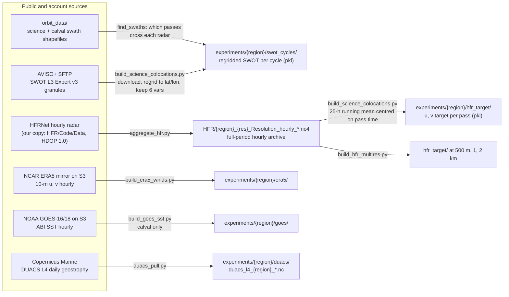
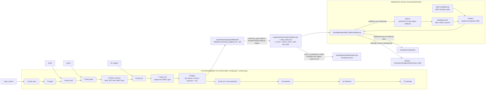
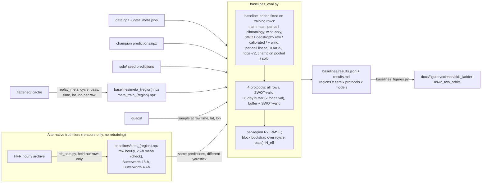

# Pipeline map

One picture of how data becomes the numbers in the paper. Three stages: get the
data onto disk, turn it into training rows and a model, score the model against
the baselines. Boxes are files or folders; arrows carry the script or module
that makes the right-hand side from the left. Renders on GitHub and in VS Code
(Mermaid). Last checked against the code 2026-10-31.

## Stage 1: sources to local mirrors

## Stage 2: mirrors to training rows to a model

## Stage 3: predictions to the paper's tables and figures

(The poster figures, fitness scatter and architecture from `database.jsonl` and
feature importances from `data.npz`, are a side branch off stage 2 and are left
off the chart; commands in the README.)

## Reading notes

- Stage 1 is the only place that costs money or needs accounts. Everything
  after it reads local mirrors. The S3 bucket `swot-ai-ssv` is our own backup
  of stage 1 outputs and is never read by compute jobs.
- The target is fixed at stage 1: a 25-hour running mean of the radar current,
  centred on the SWOT pass time. The Butterworth tiers in stage 3 do not
  retrain anything; they re-score the same predictions against alternative
  definitions of truth (`docs/research-log.md`, 2026-10-29 and 10-31). A
  Butterworth low-pass is a frequency-domain smoother: it passes oscillations
  slower than its cutoff period (18 h or 48 h here) with almost no change and
  attenuates faster ones progressively, with a flat response in the pass band
  and no ripple. Order 2 sets how steep the roll-off is; running it forward and
  backward (`filtfilt`) cancels the phase shift so the filtered value sits at
  the same hour as the raw one. Against the 25-hour boxcar, which has side
  lobes that let some tidal energy leak through, it is the cleaner way to ask
  "what is the sub-daily-free current at this hour".
- The evolve harness does not use the pipeline's `train` step. It freezes the
  flattened rows once into `data.npz` and lets each candidate's `candidate.py`
  own the whole training loop. The champion's weights are not saved; anything
  that needs predictions on new rows retrains it from `candidate.py` and
  `params.json` (`solo_vs_pooled.py`, `animate_evolve_champion.py`).
- Two independent runs exist: `evolve_all_science_v1` (21-day orbit, pooled
  over uswc, usegc, prvi, ushi, 72 input columns) and `evolve_uswc_v1` (1-day
  calval orbit, uswc only, 81 columns including SST). Stage 3 runs once per
  run; uswc_two_orbits puts the two side by side.
- Where to look when something is wrong: a missing region in stage 3 means
  its `flattened/` cache or `data.npz` span is missing (stage 2); a NaN tier
  means too few radar hours around the pass (stage 3, `hfr_tiers.py` coverage
  rule); a DUACS row count under 50 means the pull window does not cover the
  held-out dates (stage 1).
